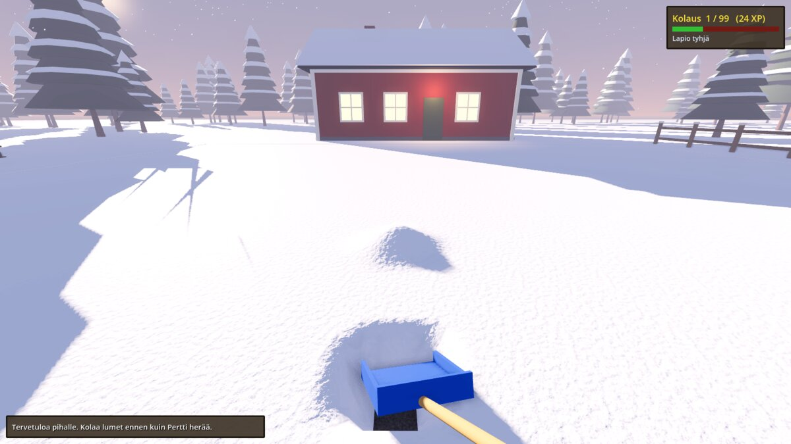
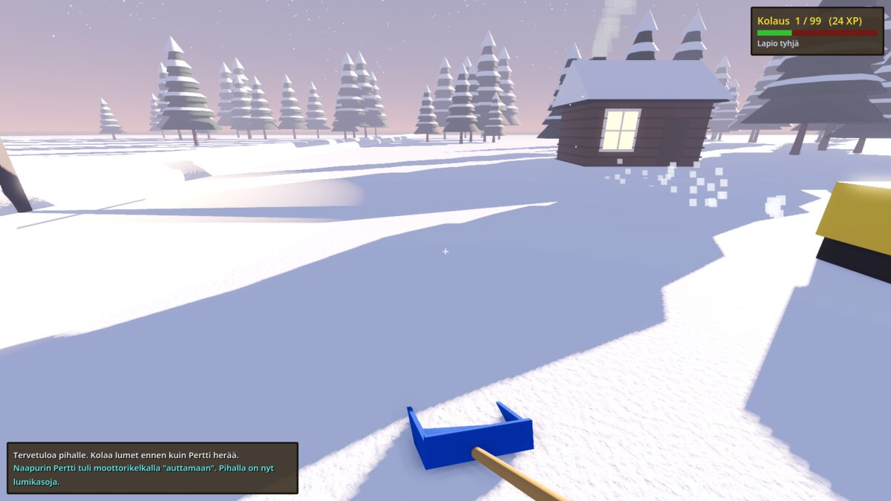
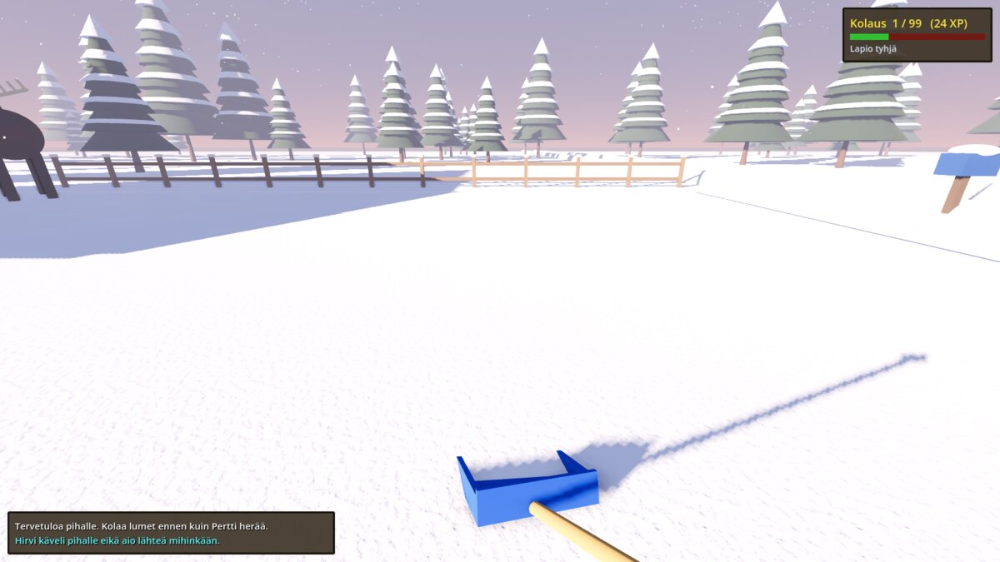

# Lumenkolaussimulaattori

> **Huom:** Tämä on läppäpeli. Se on tehty kokonaan tekoälyllä (Claude kirjoitti koodin, testasi sen pilvessä ja julkaisi buildit), ihminen lähinnä keksi idean ja nauroi. Älä odota AAA-grafiikkaa, tasapainotettua pelattavuutta tai bugitonta koodia. Odota lunta, lapio ja naapurin Pertti.

Moninpelattava lumenkolaussimulaattori suomalaisessa pihapiirissä. Mallia otetaan My Summer Carista (ensimmäinen persoona, arkinen puuha, hulluja sattumuksia), ja äänet ja taitotasot tehdään Old School RuneScapen henkeen. Tehty **Godot 4.6**:lla (GDScript), eikä pelissä ole yhtään ulkoista assettia: maisema, hahmot ja äänet luodaan koodissa.



| | |
|---|---|
|  |  |
| Naapurin Pertti tuli "auttamaan" moottorikelkalla. | Hirvi käveli pihalle eikä aio lähteä. |

## Pelaaminen

1. Lataa [uusin versio](https://github.com/Naarhi/lumenkolaussimulaattori/releases/tag/uusin): `Lumenkolaus-Windows.zip` tai `Lumenkolaus-Linux.zip`.
2. Pura ja käynnistä `Lumenkolaus.exe` (Linuxilla `lumenkolaus.x86_64`).
3. Valikossa:
   - **Liity peliin**: kirjoita palvelimen osoite muodossa `osoite[:portti]`. Tyhjänä peli yrittää kehittäjän omaa palvelinta, joka ei välttämättä ole päällä.
   - **Isännöi peliä**: oma kone toimii palvelimena ja pelaat samalla itse. Kaverit liittyvät koneesi osoitteeseen (UDP 7777).
   - **Yksinpeli**

Ohjaus: WASD liikkuu, Shift juoksee, välilyönti hyppää. Hiiren klikkaus kauhoo lunta lapiolle, ja seuraava klikkaus heittää sen. Esc vapauttaa hiiren.

## Oma palvelin Linuxilla

Julkaisussa on erillinen palvelinbuild `lumenkolaus-server.x86_64`. Se on Godotin dedikoitu palvelinvienti: ei grafiikkaa, ei ääntä, ja se käynnistyy suoraan palvelintilaan. Palvelin pitää kirjaa lumesta, XP:stä ja satunnaistapahtumista. Yhteen palvelimeen mahtuu 8 pelaajaa.

Vaatimukset: 64-bittinen Linux (x86_64, esim. Debian 12/13 tai Ubuntu 22.04+), muutama sata megatavua muistia ja yksi avoin UDP-portti. Näytönohjainta ei tarvita.

### Nopea kokeilu

```sh
curl -LO https://github.com/Naarhi/lumenkolaussimulaattori/releases/download/uusin/lumenkolaus-server.x86_64
chmod +x lumenkolaus-server.x86_64
./lumenkolaus-server.x86_64 --headless -- --port=7777
```

Terminaaliin tulee `[Net] Palvelin kuuntelee porttia 7777`. Toisesta terminaalista voi varmistaa, että portti on auki: `ss -ulnp | grep 7777`. Pelaajat liittyvät valikon **Liity peliin** -kentällä, esim. `192.168.1.20` tai `oma.osoite.fi:7777`. Huomaa `--` ennen pelin omia parametreja: sitä ennen olevat parametrit kuuluvat Godotille.

### Pysyvä palvelu systemd:llä

Luo palvelulle oma käyttäjä ja hakemisto:

```sh
sudo useradd --system --home /opt/lumenkolaus --shell /usr/sbin/nologin lumenkolaus
sudo mkdir -p /opt/lumenkolaus/server
sudo curl -L -o /opt/lumenkolaus/server/lumenkolaus-server.x86_64 \
  https://github.com/Naarhi/lumenkolaussimulaattori/releases/download/uusin/lumenkolaus-server.x86_64
sudo chmod +x /opt/lumenkolaus/server/lumenkolaus-server.x86_64
sudo chown -R lumenkolaus:lumenkolaus /opt/lumenkolaus
```

Asetukset tiedostoon `/etc/lumenkolaus.env`:

```sh
# Portti, jota palvelin kuuntelee (UDP)
LUMENKOLAUS_PORT=7777
```

Palvelutiedosto `/etc/systemd/system/lumenkolaus.service`:

```ini
[Unit]
Description=Lumenkolaussimulaattorin palvelin
After=network-online.target
Wants=network-online.target

[Service]
Type=simple
User=lumenkolaus
Group=lumenkolaus
EnvironmentFile=/etc/lumenkolaus.env
WorkingDirectory=/opt/lumenkolaus/server
ExecStart=/opt/lumenkolaus/server/lumenkolaus-server.x86_64 --headless -- --port=${LUMENKOLAUS_PORT}
Restart=on-failure
RestartSec=5

# Kevyt suojaus: palvelin ei tarvitse muuta kuin oman hakemistonsa
NoNewPrivileges=true
ProtectSystem=strict
ProtectHome=true
PrivateTmp=true
ReadWritePaths=/opt/lumenkolaus

[Install]
WantedBy=multi-user.target
```

Käynnistä ja tarkista:

```sh
sudo systemctl daemon-reload
sudo systemctl enable --now lumenkolaus
systemctl status lumenkolaus
journalctl -u lumenkolaus -f
```

### Portti ja palomuuri

- Palvelin käyttää **UDP**:tä (ENet). TCP-portin avaaminen ei riitä.
- Palomuuri, esim. ufw: `sudo ufw allow 7777/udp`
- Jos kaverit tulevat netin yli, ohjaa reitittimestä UDP 7777 palvelinkoneelle. Jos kotisi julkinen IP vaihtuu, DDNS-osoite (esim. DuckDNS tai reitittimen oma DDNS) on helpompi jakaa kuin IP.
- Cloudflare Tunnel ja muut HTTP-tunnelit eivät välitä peli-UDP:tä.

### Päivitys

GitHub Actions kääntää jokaisesta `main`-haaran muutoksesta uuden version samaan `uusin`-julkaisuun. Päivitä palvelin näin (asiakkaiden kannattaa päivittää samalla, koska eri versiot eivät välttämättä ymmärrä toisiaan):

```sh
sudo systemctl stop lumenkolaus
sudo curl -L -o /opt/lumenkolaus/server/lumenkolaus-server.x86_64 \
  https://github.com/Naarhi/lumenkolaussimulaattori/releases/download/uusin/lumenkolaus-server.x86_64
sudo chmod +x /opt/lumenkolaus/server/lumenkolaus-server.x86_64
sudo systemctl start lumenkolaus
```

### Vianetsintä

- **Kaverit eivät pääse sisään, mutta lähiverkossa toimii:** reitittimen porttiohjaus tai palveluntarjoajan CGNAT. Tarkista, että reitittimen ulkoinen IP on sama kuin esim. osoitteessa ifconfig.me näkyvä.
- **`Permission denied`:** binääriltä puuttuu suoritusoikeus (`chmod +x`).
- **Palvelu kaatuilee:** katso syy komennolla `journalctl -u lumenkolaus -n 100`.

## Mitä pelissä on

| Osa | Tiedosto | Mitä tekee |
|---|---|---|
| Verkko | `scripts/net.gd` | ENet-palvelin ja -asiakas, komentoriviparametrit ja näppäimet. |
| Lumikenttä | `scripts/snow_field.gd` | 19,2 x 19,2 m pihan lumi 10 cm:n ruudukkona. Palvelin lähettää vain muuttuneet 16 x 16 solun palat. Lunta sataa hiljalleen lisää. |
| Pelilogiikka | `scripts/main.gd` | Valikko, pelaajien luonti, lapio (kauho ja heitä), jalanjäljet ja XP. |
| Pelaaja | `scripts/player.gd` | Ensimmäisen persoonan hahmo. Syvä lumi hidastaa. |
| Taidot | `scripts/skills.gd` | Kolaus-taito OSRS:n XP-käyrällä (taso 2 = 83 XP, taso 99 = 13 034 431 XP). |
| Satunnaistapahtumat | `scripts/random_events.gd` | Aura-auto, lumimyräkkä, hirvi, naapurin Pertti moottorikelkalla ja kattolumi. 1,5–4 minuutin välein. |
| Äänet | `scripts/retro_sfx.gd` | OSRS-henkiset retroäänet syntetisoidaan koodissa, ei äänitiedostoja. |
| Maisema | `scripts/pihapiiri.gd` | Hämärä talvitaivas, punainen talo, sauna, aita, postilaatikko, katulamppu, kuusimetsä ja tie. |
| Käyttöliittymä | `scripts/hud.gd` | Päävalikko, OSRS-tyylinen chat, taitopaneeli ja tasonnousu. |

Kaikki pelin tila (lumi, XP, tapahtumat) on palvelimella. Asiakas lähettää vain lapion käytön, ja liike synkronoidaan muille.

## Kehitys

Avaa kansio Godot 4.6 -editorissa ja paina F5. Komentoriviltä:

```
godot --path . -- --host                 # isännöi
godot --path . -- --connect=127.0.0.1    # liity
godot --headless --path . -- --server    # pelkkä palvelin
tests/multiplayer_test.sh                # palvelin + 2 automaattista asiakasta
```

Muut parametrit: `--port=7777`, `--autotest`, `--screenshot=kuva.png`, `--event=0..4` (laukaisee tapahtuman testissä), `--yaw=astetta`.

Kuvakaappaukset otetaan ilman näyttöä:

```
xvfb-run -a -s "-screen 0 1600x900x24" godot --path . --rendering-method gl_compatibility \
  --rendering-driver opengl3 -- --host --autotest --screenshot=kuva.png
```

GitHub Actions ajaa lumi- ja moninpelitestit jokaisesta muutoksesta ja julkaisee mainista Windows-, Linux- ja palvelinbuildit julkaisuun `uusin`. Vanha Unreal Engine -kokeilu on haarassa `unreal-arkisto`.

## Lisenssi

[MIT](LICENSE). Saat käyttää, muokata ja jakaa koodia vapaasti, kunhan lisenssiteksti kulkee mukana. Peli on tehty [Godotilla](https://godotengine.org/), joka on myös MIT-lisensoitu.
